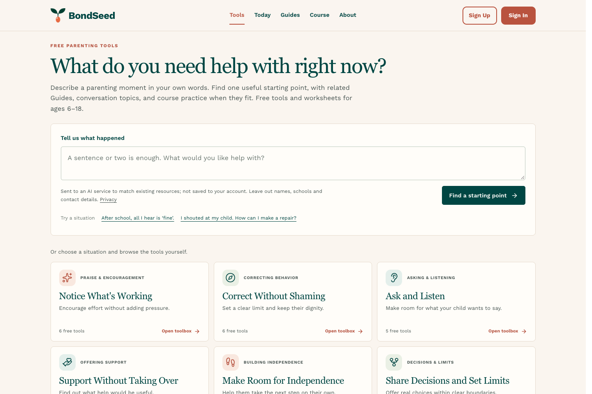
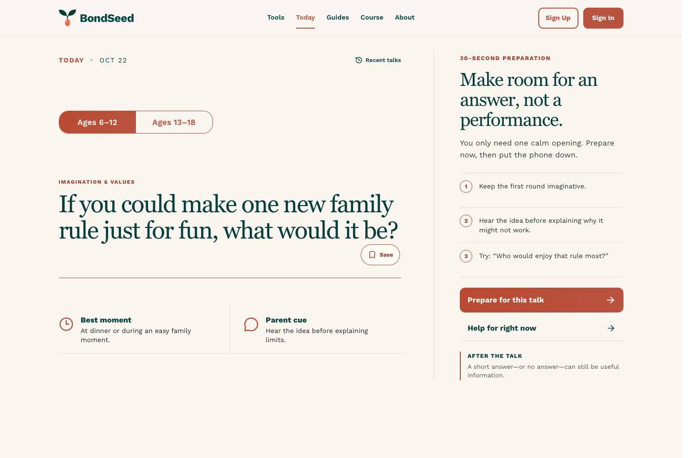
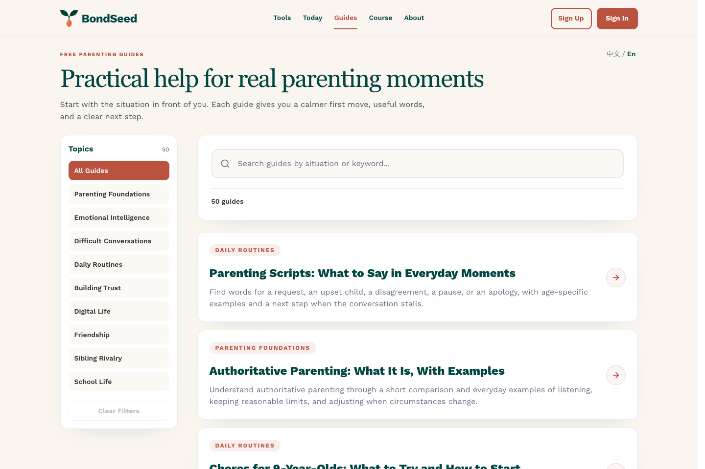
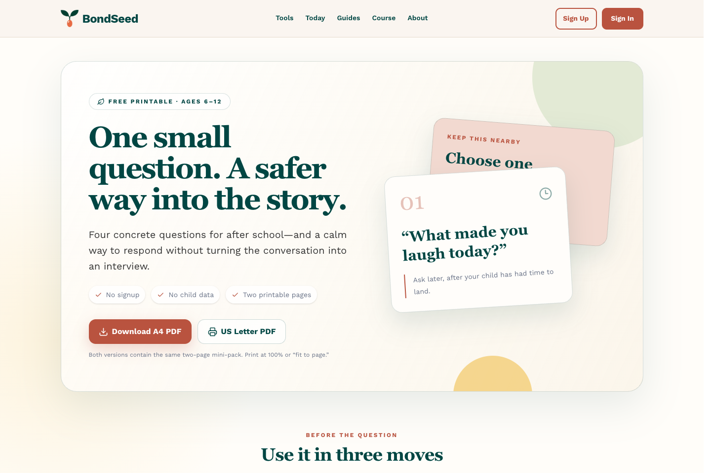

# BondSeed

**Practical help for everyday parent–child conversations.**

English · [简体中文](README.zh-CN.md)

I'm McFly Shi, a dad who started with little cards to make after-school conversations easier. Today, BondSeed brings together free tools, daily conversation starters, Guides, and printables for parents and caregivers of children ages 6–18.

**[Visit BondSeed](https://www.bondseed.com/?utm_source=github&utm_medium=referral&utm_campaign=bondseed_home&utm_content=en_readme_hero)** · [Project introduction](https://mcflysj.github.io/bondseed-home/)

## Find a place to start

- **Not sure what to say?** [Try a daily conversation starter.](https://www.bondseed.com/today?utm_source=github&utm_medium=referral&utm_campaign=bondseed_home&utm_content=en_readme_start)
- **Facing a tricky moment?** [Find a practical Guide.](https://www.bondseed.com/articles?utm_source=github&utm_medium=referral&utm_campaign=bondseed_home&utm_content=en_readme_start)
- **Want something to take away?** [Print the free after-school cards.](https://www.bondseed.com/resources/one-small-moment-after-school?utm_source=github&utm_medium=referral&utm_campaign=bondseed_home&utm_content=en_readme_start)

## See what you can try

### Start with one small question

Today offers a daily conversation starter, with suggestions for ages 6–12 and 13–18. Try one at dinner or during an unhurried moment together.

[Try Today →](https://www.bondseed.com/today?utm_source=github&utm_medium=referral&utm_campaign=bondseed_home&utm_content=en_readme_today)

### Find words for a real moment

Browse practical Guides on listening, everyday routines, difficult conversations, and more. Find example wording and steps you can adapt to your family.

[Explore the Guides →](https://www.bondseed.com/articles?utm_source=github&utm_medium=referral&utm_campaign=bondseed_home&utm_content=en_readme_guides)

### Bring a little card along

The free after-school pack includes four conversation questions and a listening guide for ages 6–12. Download two printable pages in A4 or US Letter.

[Get the free conversation cards →](https://www.bondseed.com/resources/one-small-moment-after-school?utm_source=github&utm_medium=referral&utm_campaign=bondseed_home&utm_content=en_readme_after-school)

*Actual screenshots from bondseed.com · October 22, 2026.*

## Free resources and the course

Tools, worksheets, Today, and Guides are free without an account. The nine-skill communication course includes a complete free first chapter. Lifetime access unlocks Chapters 2–9 and future course updates.

[Read the free first chapter](https://www.bondseed.com/courses/chapter1?utm_source=github&utm_medium=referral&utm_campaign=bondseed_home&utm_content=en_readme_course)

## Why I created BondSeed

Hi, I'm McFly Shi, the founder of BondSeed and an ordinary dad. I'm not a parenting expert, and I don't have professional qualifications in psychology. What I bring here is eighteen years of growing alongside my son, and the experiences and reflections I've gathered along the way.

From his first days and first words to sports and school, I've watched my son grow. Now he's at university away from home. The everyday moments we once shared have given way to missing him from a distance. We have fewer days together each year, and I find myself looking back more often on the years that brought us here.

Those eighteen years have held joy, uncertainty, worry, and plenty of moments when I didn't know what to do. I've made mistakes, and I've often had to rethink how to be a father. Seeing my son become a kind, independent person fills me with gratitude. I've learned so much from him, too. As he has grown, I've been learning to be a better dad.

BondSeed began with something small and ordinary.

When my son was in primary school, I'd pick him up each afternoon hoping we could have a good conversation, but I often struggled to find a way in. So I began writing things I'd like to talk about on little cards. Behind those cards was a simple wish: to understand more of his world, and to give us more moments when we wanted to share something with each other.

Now that I have more time of my own, I want to bring those cards together with what I've learned over the years and share them with parents who are looking for ways to connect with their children. That's why I created BondSeed.

The content here grows out of my experience as a father. I also read relevant books and research, reflecting on them alongside my own experience to put together conversation topics and approaches you might like to try. Every child and every family is different. I hope you'll find something here that helps you discover what works for you and your child.

Parenting asks a lot of us. Thank you for being here and for making time to care for your relationship with your child. I'm glad to have your company on this journey. I'll keep working on BondSeed with care, and I hope that, even in the busy and uncertain parts of family life, we can make a little more room for listening and understanding, and enjoy the good moments as we grow alongside our children.

— McFly Shi · Founder of BondSeed

## Content, privacy, and contact

I publish under the BondSeed name and take responsibility for editing, references, and corrections. The resources offer general communication education. Examples are for you to adapt; they are not promises of a particular outcome.

Worksheet entries stay in the current browser tab; download or print them before leaving. If you use the situation finder, your description is sent to an AI service to match existing resources. Leave out names, schools, and contact details.

[About BondSeed](https://www.bondseed.com/about?utm_source=github&utm_medium=referral&utm_campaign=bondseed_home&utm_content=en_readme_policy) · [Editorial Policy](https://www.bondseed.com/editorial-policy?utm_source=github&utm_medium=referral&utm_campaign=bondseed_home&utm_content=en_readme_policy) · [Sources & references](https://www.bondseed.com/sources?utm_source=github&utm_medium=referral&utm_campaign=bondseed_home&utm_content=en_readme_policy) · [Privacy](https://www.bondseed.com/privacy-policy?utm_source=github&utm_medium=referral&utm_campaign=bondseed_home&utm_content=en_readme_policy)

Questions, ideas, or a correction? [contact@bondseed.com](mailto:contact@bondseed.com)

If something here helps, you're welcome to share the relevant resource with another parent. A small, useful idea can be a good place to begin.

**[Explore BondSeed](https://www.bondseed.com/?utm_source=github&utm_medium=referral&utm_campaign=bondseed_home&utm_content=en_readme_closing)**
